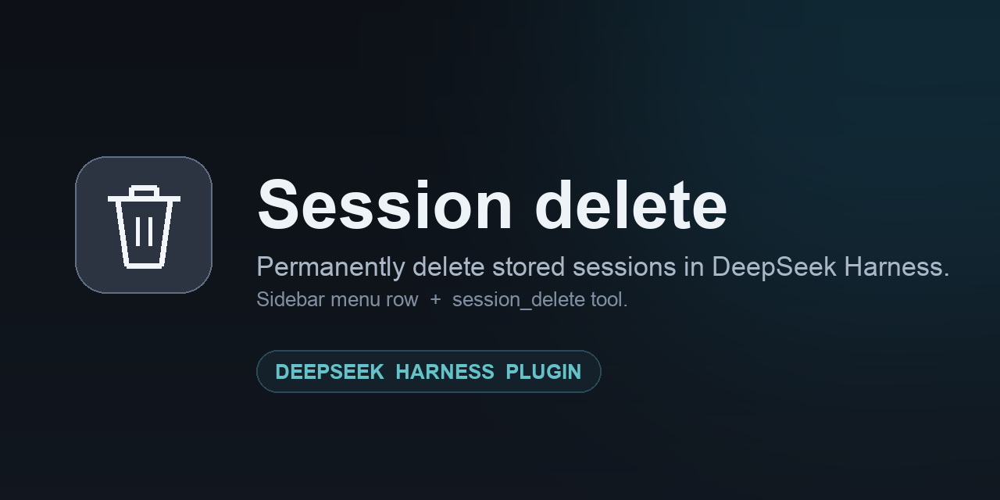

# Session delete — DeepSeek Harness plugin



[](LICENSE)
[](https://github.com/deepseek-ai)

DeepSeek Harness stores sessions as append-only logs, but it ships no way to
delete one: the persistence service can create, open, list, and stat a session,
and never remove it. This bundle adds that missing operation once and exposes it
to both the human and the agent.

## What you get

| Surface | What it does |
| --- | --- |
| Sidebar Session menu | **Delete session** row, next to the built-in Archive action. Asks for confirmation, then removes the session from the list without a page reload. |
| `session_delete` tool | Lets the agent delete a stored session by id, with the same rules and the same result shape as the menu row. |

## Safety rules

- Only canonical `session-<uuid>` ids are accepted.
- A session that is open (live agent, or still retained in memory) is refused —
  close it first.
- The directory is resolved from the persistence snapshot for that exact id, and
  must be named after the id and contain a session log or lock file.
- Deletion is permanent. The log, lock, and every other artifact in the session
  directory are removed; no archive copy is kept.

## Install

The plugin targets the **web** profile (`desktop`, `web`, or any base-backed
profile with the Web GUI). Installing a bundle enables it by default; restart or
remove it the same way as any other bundle.

### Option A — ask your agent

```
Install this DeepSeek Harness bundle and enable it:
github:ningyizhu0/dsh-session-delete
```

The agent calls `plugin_manager` with `install_bundle`, which installs the
package and selects the bundle in one step.

### Option B — Plugins page

Open **Plugins → Add**, paste `github:ningyizhu0/dsh-session-delete`, install,
then turn the bundle **On** if it is not selected already.

### Option C — CLI

```sh
dsh plugin --profile "$DSH_PROFILE" add github:ningyizhu0/dsh-session-delete
```

Installing this way records the dependency only. Select **Session delete** in the
Plugins page to activate it.

Refresh the Web page once after installing: the client half mounts with the
page's module table.

## Use

### From the sidebar

1. Right-click a session in the sidebar (or open its `...` menu).
2. Choose **Delete session**.
3. Confirm. The row disappears; the log is gone.

Deleting an archived or cold session works the same way.

### From the agent

The `session_delete` tool takes one argument:

```json
{ "sessionId": "session-5d69ca9a-c5d5-4de3-9016-224aba1b56f2" }
```

It returns `{ "ok": true, "sessionId": "…" }` on success, or
`{ "ok": false, "error": "not-found" | "session-live" | "…", "message": "…" }`.

## How it works

- `index.js` (Host) owns the deletion operation. It reads the session location
  from `ctx.sessionPersistence.stat(id)`, refuses open sessions, validates the
  directory, removes it, and emits `api-session/removed` so the open page drops
  the row. It registers the `session_delete` tool and a same-origin
  `POST /session-delete/delete` route.
- `client.js` (Web) registers one data row in the sidebar Session menu through
  the Context Menu service, plus a trash icon for it. The row confirms, posts the
  id to the Host route, and reports a refusal.

## Compatibility

Tested with DeepSeek Harness `0.2.2-rc.1` on macOS. The bundle declares
`>=0.2.2-rc.1 <0.3.0`. The menu row relies on the Web Context Menu service; the
tool and the route work on any Host profile that mounts `sessionPersistence` and
`tools`.

## Package layout

```
package.json        bundle manifest, dsh.client declaration, files list
cordis.patch.yml    inserts the single Host row
index.js            Host half: deletion operation, tool, route
client.js           Web half: sidebar menu row, confirmation, icon
locale/en.json      Plugin Manager title and description
locale/zh.json        same, Chinese
icon.svg            plugin artwork
docs/banner.png     README artwork
```

## License

MIT — see [LICENSE](LICENSE).
